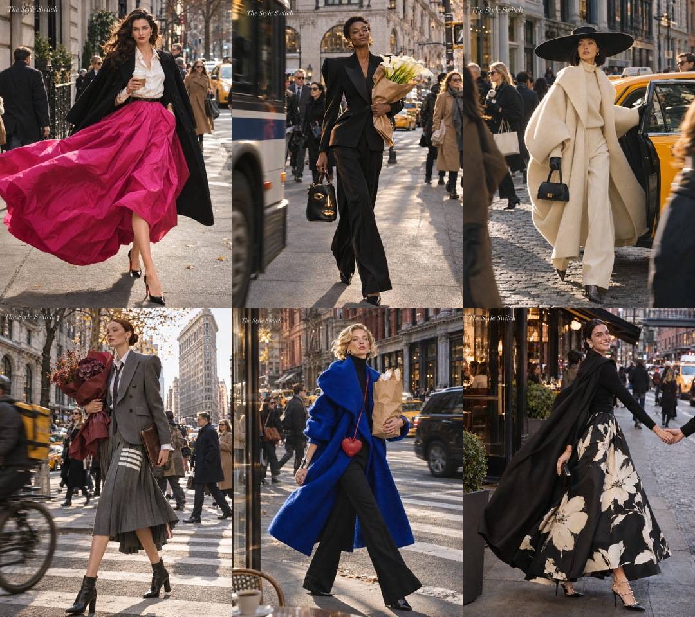

# The Style Switch · 曼哈顿盛装日常

2026-11-12 图文发布素材归档。六个虚构成年女性造型，从咖啡、花束、出租车到晚餐。第6张已修正牵手朝向。

## 浏览与使用

下载仓库后，在本机打开 `index.html`，即可浏览六张图片、四种比例封面及按平台分别撰写的中英文文案。页面全部使用仓库相对路径，不依赖作者电脑目录。

- `01-组图`：六张3:4图片，仅保留品牌字标。
- `02-封面/通用`：4:3、3:4、16:9、9:16独立构图。
- `04-文案`：小红书、抖音、TikTok、Instagram、Bilibili分别适配。
- `05-附加资料`：品牌来源、SKU逐项范围、编辑方案、尺寸核验。
- `发布说明.md`：文件使用顺序与平台适配说明。
- `文件清单.json`：每个交付文件的SHA256和大小。

## 商品范围

本期图片包含概念服装与真实单品的设计参考，**不是全部真实SKU的精确复刻**。具体区别见[SKU逐项核查说明](05-附加资料/SKU逐项核查说明.json)。不将生成图当作商品实物识别依据，不暗示品牌合作。

图片由AI创作。本次仅将成品与必要说明归档至GitHub；未因此发布或修改任何社交平台帖子。

## 版本

本次归档采用已清除广告式图面文字、已修正第6张牵手、已重写平台正文的版本。工作缓存、API凭据、私人文件和无关项目不在本仓库中。
